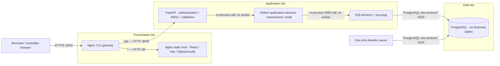

# Architecture and design decisions

## Three tiers

Only the gateway publishes a host port. Static files never connect to PostgreSQL. The browser fetches relative `/api` URLs; same-origin routing avoids unnecessary CORS. Container-network HTTP is confined to the local host's isolated Docker networks; the required browser-facing REST connection is HTTPS. A deployment across separate machines would additionally require TLS on inter-host links.

Primary requirements: brief R1/R2/R3, pp. 7–10. Proposed protocol is **Option A**. Host HTTPS port 8443 maps to gateway TLS port 443; upstream ports 80/8000/5432 are private. The full diagram includes planned auth/lending responsibilities; only the read-only catalog slice exists now. A two-tier design is a permitted R7B comparison topic, never the architecture to implement.

Compose separates presentation, application and data networks. API joins application/data; gateway joins presentation/application; PostgreSQL joins data only. Database and API have no published host port. Migrations wait for database readiness; API waits for migration success; gateway waits for API readiness. Synthetic seeds are explicit, not an every-start data reset.

## Module responsibilities

`config.py` loads environment secrets; `db.py` manages scoped sessions; `models.py` maps persistence; `schemas.py` defines response validation; `catalog.py` builds parameterized availability queries; `main.py` exposes initial routes and safe error handlers; `seed.py` adds synthetic catalog rows idempotently. Separate `auth`, `accounts`, `inventory`, `requests` and `loans` routers/services will be added in Phase 2; they are not empty placeholder modules here.

The immutable SQL migration is the schema authority. SQLAlchemy metadata is intentionally a mapping, not a complete representation of partial/exclusion/trigger constraints. Never run `create_all()` or blindly accept an autogenerated migration as a replacement. Review SQL migrations and extend the metadata if autogeneration is later adopted.

## Client-side storage decision (R3)

PostgreSQL is the authoritative business store. Current React state holds fetched catalog rows, filters, pagination and open-dialog state **in memory only**; reload refetches from the API. This version uses no localStorage, sessionStorage or IndexedDB for business records, credentials or preferences. Requests/error responses use no-store at the API; immutable static assets may be cached. Browser history can still retain public navigation URLs, and loaded data is visible on the current device.

Phase 2's proposed Secure/HttpOnly/SameSite session cookie is an authentication mechanism, not a second authoritative business store. Document its actual contents/expiry, CSRF storage and risks after implementation. Never persist password hashes, DB credentials or personal borrowing history in browser storage.

## Planned transactional boundaries

For every mutation, open a single database transaction. Lock the equipment row first with `SELECT ... FOR UPDATE`, then the request row when applicable, and reread current state. For request operations, obtain the immutable equipment ID, lock equipment then refetch/lock request; avoid inconsistent lock ordering between endpoints. Date and ownership checks happen in application services, inside the same transaction as necessary state checks.

Approval locks equipment/request, verifies pending state and administrator authority, checks interval overlaps and known active-loan conflicts, records decision and audit. The PostgreSQL GiST exclusion constraint rejects a conflicting approved/released interval even if an application check races. Catch the expected integrity violation and return 409 without leaking SQL.

Release locks equipment/request, verifies approval and allowed release time, verifies item serviceability and absence of an active loan, inserts the loan, transitions request to released, and appends the audit. The partial unique index on equipment with `returned_at IS NULL` blocks simultaneous active loans. A composite foreign key ensures the loan equipment matches the request.

Return locks equipment/request/loan in that order, rejects already-returned records, records server return time and condition, updates request to returned, updates item condition/service status, and appends the audit. Commit all changes together. Damage requires maintenance. Availability is derived from service state + actual loans + approved reservation intervals, so there is no stale stored `available` boolean to toggle.

Overdue is derived from request due time and actual return status; no background task is required for correctness. Return releases the reservation predicate by transitioning the request out of approved/released. Read-only availability uses correlated EXISTS queries; pagination and bounded search prevent unbounded catalog responses. Current search uses safe substring matching; the ordinary name index does not accelerate arbitrary substrings. Introduce and measure a trigram index if the real dataset warrants it.

## Security decisions and current limits

The container API uses a separate non-owner read-only PostgreSQL role. The migration owner is supplied only to one-shot migration/seed services. Phase 2 must add minimal DML grants and an audit INSERT grant without audit UPDATE/DELETE/TRUNCATE. Owner credentials never enter the browser image. `.env`, certificates, private keys, dumps and local environments are ignored.

Phase 2 selects Argon2id and server-validated roles/ownership, cookie protections, CSRF, login throttling and invalidation. Do not claim these exist in Phase 1. Disable Swagger CDN dependence or self-host its assets for a fully offline final demonstration; initial `/api/docs` uses FastAPI's standard external Swagger assets, while `/api/openapi.json` is local. API errors use `{error:{code,message,request_id}}`; validation errors omit submitted values and SQL exceptions return safe 503 messages. Unexpected errors return a generic 500.

The audit trigger blocks updates/deletes/truncates at database level, including accidental owner DML. It is not tamper-proof against a privileged database operator who can disable triggers or alter schema. Backups and access separation provide additional controls; audit retention/controlled erasure requires an approved policy before real personal data.

TLS configuration and safe file defaults are provided, but certificate trust, Linux runtime, browser behavior and second-device access must be verified after infrastructure setup. No system software, CA trust store or firewall change was made by this increment.
