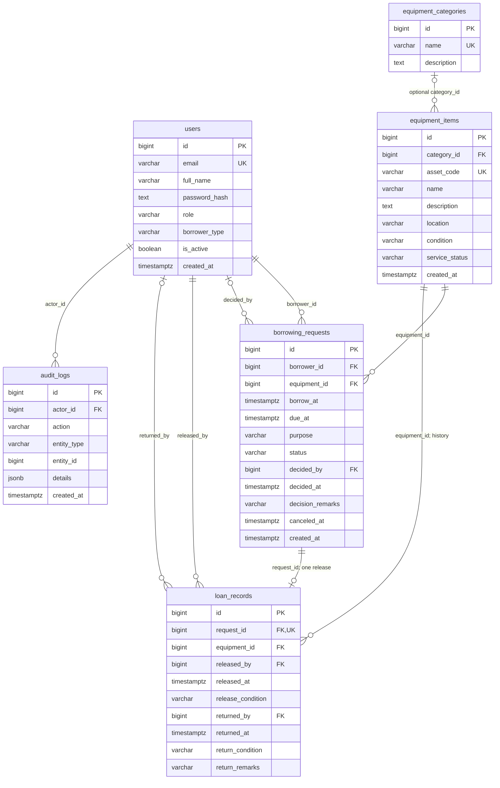

# Database design and dictionary

PostgreSQL 17; revision `0001_initial`. The authoritative DDL is `backend/migrations/versions/0001_initial.sql`; Alembic executes it transactionally. The schema has exactly the six proposed business tables plus Alembic's technical version table. All foreign keys restrict deletion. All IDs are generated `bigint` identity primary keys. All timestamps are timezone-aware. Dates in examples are synthetic.

Department interface update, November 24, 2026: forward revision `0004_optional_equipment_category` makes `equipment_items.category_id` optional. New equipment does not require a category, and catalog queries include uncategorized equipment. Existing category assignments and records are preserved when editing without a category. Category controls and labels are removed from all user interfaces; the legacy API fields remain compatible. The remaining dictionary documents the original business-table foundation; later migrations also add sessions and password-recovery tables.

Primary academic reference: brief R3, p. 10, requires at least three related tables, ERD/dictionary, an authoritative server database, explained client storage, and a demonstrated restore. The six-table design meets the planned size/relationship requirement but its execution/restore evidence is still pending. Client state/storage decisions are recorded in ARCHITECTURE.md; no browser store replaces this database.

## ERD

`entity_id` is a polymorphic audit reference, not a misleading FK to multiple tables. Validate entity type/reference in the application. Historical foreign keys to people/items retain records when accounts deactivate or items retire. The role of a referenced user (borrower versus deciding/releasing admin) is an application authorization rule, not a simple FK guarantee.

## Data dictionary

Unless marked nullable, fields are required.

### users

| Column | Type | Meaning / constraint |
|---|---|---|
| id | bigint | Identity PK |
| email | varchar(254) | Unique, normalized lowercase; synthetic addresses use example.invalid |
| full_name | varchar(120) | Nonblank display name |
| password_hash | text | Argon2id hash in Phase 2; never plaintext or API output |
| role | varchar(16) | borrower or admin |
| borrower_type | varchar(16), nullable | student/faculty required for borrower; null for admin |
| is_active | boolean | Default true; deactivate instead of deleting |
| created_at | timestamptz | Default database now() |

### equipment_categories

| Column | Type | Meaning / constraint |
|---|---|---|
| id | bigint | Identity PK |
| name | varchar(80) | Unique category label |
| description | text | Category explanation; default empty string |

### equipment_items

| Column | Type | Meaning / constraint |
|---|---|---|
| id | bigint | Identity PK |
| category_id | nullable bigint FK | Optional legacy category, restrict deletion |
| asset_code | varchar(40) | Unique nonblank school asset identifier |
| name | varchar(120) | Nonblank equipment name |
| description | text | Public equipment description; default empty |
| location | varchar(120) | Synthetic storage location |
| condition | varchar(16) | good / fair / damaged; default good |
| service_status | varchar(16) | serviceable / maintenance / retired; default serviceable |
| created_at | timestamptz | Default now() |

Damaged condition cannot be serviceable. Availability is computed, not stored: retired/maintenance service status takes precedence, then active loan, then a current approved/released interval, otherwise available. Future interval availability is a Phase 2 API extension.

### borrowing_requests

| Column | Type | Meaning / constraint |
|---|---|---|
| id | bigint | Identity PK |
| borrower_id | bigint FK | Request owner |
| equipment_id | bigint FK | One individual item |
| borrow_at | timestamptz | Intended start instant |
| due_at | timestamptz | Expected return instant; strictly after start |
| purpose | varchar(500) | Trimmed content length at least 5; never put secrets here |
| status | varchar(16) | pending / approved / rejected / canceled / released / returned |
| decided_by | bigint FK, nullable | Admin decision actor; required for decided/released/returned states |
| decided_at | timestamptz, nullable | Decision instant paired with actor |
| decision_remarks | varchar(500), nullable | Optional decision explanation |
| canceled_at | timestamptz, nullable | Present exactly when canceled |
| created_at | timestamptz | Default now() |

`(id, equipment_id)` is additionally unique for a composite loan FK. A GiST exclusion constraint with `btree_gist` prevents equal equipment IDs with overlapping `tstzrange(borrow_at,due_at,'[)')` for status approved/released. Pending/rejected/canceled/returned rows do not reserve periods. PostgreSQL does not enforce all cross-table state transitions here: Phase 2 services must validate roles, ownership, release state and actual return atomically.

### loan_records

| Column | Type | Meaning / constraint |
|---|---|---|
| id | bigint | Identity PK |
| request_id | bigint, unique FK | One release per request; composite FK with equipment_id |
| equipment_id | bigint FK | Same equipment as referenced request |
| released_by | bigint FK | Releasing administrator |
| released_at | timestamptz | Actual server release time; default now() |
| release_condition | varchar(16) | good / fair; damaged releases prohibited |
| returned_by | bigint FK, nullable | Administrator recording return |
| returned_at | timestamptz, nullable | Actual return; cannot precede release |
| return_condition | varchar(16), nullable | good / fair / damaged |
| return_remarks | varchar(500), nullable | Return observation; null before return |

All core return fields appear together; remarks are optional only after return. Partial unique index `one_active_loan_per_item` on equipment_id where returned_at is null permits many historical loans but only one active loan per asset. A returned loan cannot be reused for a second release.

### audit_logs

| Column | Type | Meaning / constraint |
|---|---|---|
| id | bigint | Identity PK |
| actor_id | bigint FK | Authenticated user responsible |
| action | varchar(40) | Allowlisted service event, e.g. request.approved |
| entity_type | varchar(40) | Allowlisted request / loan / equipment / user |
| entity_id | bigint | Referenced entity ID, validated by service |
| details | jsonb | Object of safe state metadata; default {}; no credential/token/body dumps |
| created_at | timestamptz | Server event time; default now() |

Append-only trigger blocks UPDATE, DELETE and TRUNCATE. Application grants are read-only in this phase and will gain INSERT on audits in Phase 2. A DBA can alter triggers/schema; this is not a cryptographic audit ledger.

## Indexes and integrity

Unique email/category/asset/request keys create indexes. Additional indexes cover item category and lower(name), request borrower+creation and status+due, equipment request lookup, loan return state, audit entity/time and actor/time. The exclusion constraint creates its GiST index; the partial unique loan index protects active custody. Substring search is bounded but not optimized by the ordinary lower(name) index; measure before adding `pg_trgm`.

Application services must serialize state changes on the equipment row and validate cross-table invariants. Database-only inserts by the migration owner can bypass application role/transition rules; owner credentials are not runtime credentials. Concurrency acceptance requires real PostgreSQL tests and cannot be established using SQLite or mocks.

## Migration, seed and recovery

`alembic upgrade head` executes the initial SQL; it does not silently reset tables. Downgrade deliberately raises rather than deleting business data. Create a new forward migration for changes. `python -m app.seed` adds four categories and eight synthetic assets, uses parameterized inserts and leaves existing assets untouched. No real users or login passwords are created in this increment.

Use `scripts/backup.sh` and `scripts/restore.sh` from WSL Bash. Restore only into a new `equiptrack_restore_*` database. Dumps contain operational data once users/loans exist; protect and expire them under an approved retention policy. Restore validation remains pending.
